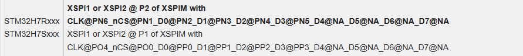
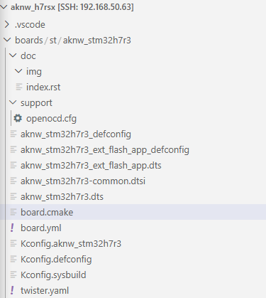
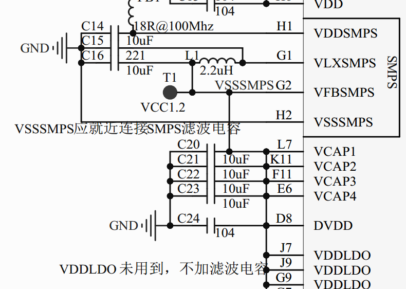
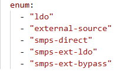
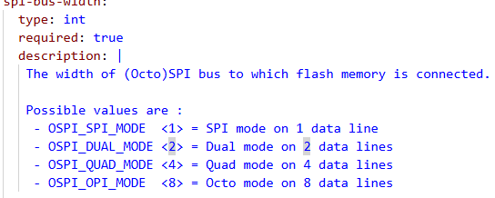
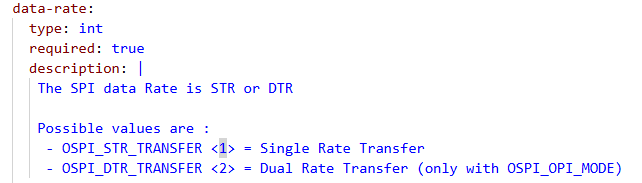
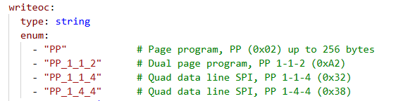
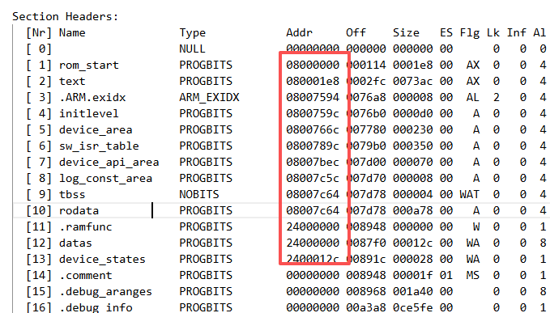
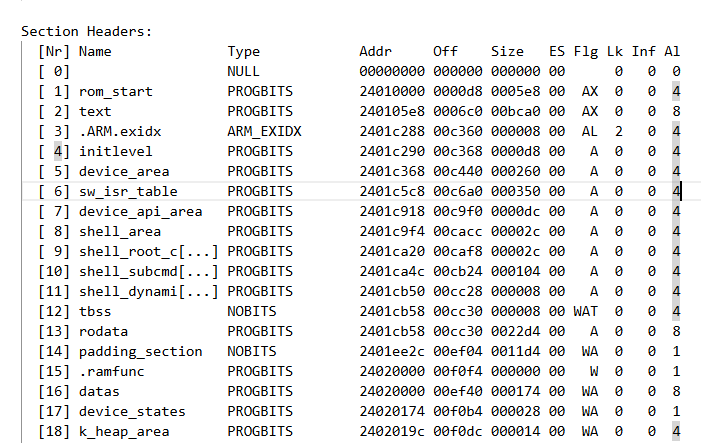

## 1. STM32H7片外flash烧写
### 1.1 芯片简介
- STM32H7Rxx8器件集成了高速嵌入式存储器、64 KB用户Flash存储器和128 KB系统Flash存储器、容量高达620 KB的RAM（其中包括可在ITCM和AXI之间共享的128 KB RAM、64 KB专用ITCM、128 KB DTCM、64 KB专用DTCM、32 KB AHB以及4 KB备份RAM），以及大量连接到APB总线、AHB总线、2个32位多AHB总线矩阵的增强型I/O和外设和支持内外部存储器访问的多层AXI互连。为提高应用稳健性，所有存储器都具有错误代码校正功能（一种纠错功能、两种错误检测功能）。
- 由于64KB用户FLASH对于一般的软件开发不够用，故需要使用到片外FLASH。
### 1.2 烧录片外FLASH
  - 根据 ST STM32H7 -SEGGRER Knowledge Base：https://kb.segger.com/ST_STM32H7#QSPI_Support 中，与内部 Flash 相比，QSPI Flash 的编程（烧录）需要特殊处理，J-Link 支持 STM32H7 的多种引脚配置。默认加载器以粗体显示，具体如下图，换句话说，只要QSPI/XSPI是按照下面的io口来连接，便可以通过JLink直接进行烧录。
  
 - 本开发板中，FLASH的使用的IO为表格中的配置2，故可以通过一下命令进行烧录
```
JLinkExe -device "STM32H7R3L8?BankAddr=0x90000000&Loader=CLK@PO4_nCS@PO0_D0@PP0_D1@PP1_D2@PP2_D3@PP3_D4@NA_D5@NA_D6@NA_D7@NA" -if SWD -speed 4000

loadfile build/hello_World/zephyr/zephyr.signed.bin 0x90000000
```  
- GDB调试
```
JLinkGDBServer -device STM32F407ZG -if SWD -speed 4000
~/work/zephyr/zephyr-sdk-1.0.1/gnu/arm-zephyr-eabi/bin/arm-zephyr-eabi-gdb build/hello_world/zephyr/zephyr.elf
(gdb) target remote localhost:2331
(gdb) b main
(gdb) c
x/4xw 0x08080000
monitor reset
set $sp = 0x20003d40
set $pc = 0x08001f3d
c
```
## 2. BSP移植
- 主要参照官方开发板NUCLEO-H7S3L8来进行BSP移植，NUCLEO-H7S3L8使用的是STM32H7S3L8，与STM32H7R3L8同属于STM32H7RS系列，且硬件资源相似。
### 2.1 board目录
#### 2.1.1 defconfig
- 本board命令为aknw_stm32h7r3，具体目录如下：
  
- board中存在两个不同的配置defconfig，定义了两种变体：
	- aknw_stm32h7r3_defconfig只用片内flash，对应设备树aknw_stm32h7r3.dts,编译时，使用：
	```
	west build -b aknw_stm32h7r3 -p always
	```
	- aknw_stm32h7r3_ext_flash_app_defconfig使用--sysbuild,加入了MCUBOOT,将应用程序存储与片外QSPI FLASH中，对应设备树aknw_stm32h7r3_ext_flash_app_defconfig，具体在twister.yaml中说明，编译时，使用：	  
	```
	west build -b aknw_stm32h7r3/stm32h7r3xx/ext_flash_app --sysbuild -p always
	```
#### 2.1.2 aknw_stm32h7r3-common.dts
aknw_stm32h7r3-common.dtsi设备树定义了整个board的外设，基本可以按照官方开发板的配置（修改pinctrl），主要修改点如下（除修改pinctrl外）： 
 1. pwr节点
	- 根据原理图，该板使用的是SMPS电源，而非LDO,此处需要修改,具体配置可查看：https://docs.zephyrproject.org/latest/build/dts/api/bindings/power/st%2Cstm32h7rs-pwr.html#std-dtcompatible-st-stm32h7rs-pwr
   
   
```dts
&pwr {
	power-supply = "smps-direct"; //根据原理图接的是smps
};
```
具体参数可查看st,stm32-xspi-nor.yaml（里面包含st,stm32h7rs-pwr.yaml）
 
2. xpsi1节点
   - 主要根据 st,stm32-ospi-nor.yaml里面进行参数修改
	   - 该板QSPI，spi-bus-width应该为QSPI：spi-bus-width =  <XSPI_QUAD_MODE>，
		  
   - data-rate 改为单边沿：data-rate = <XSPI_STR_TRANSFER>;
     
   - 增加：jedec-id = [52 21 18];
   - 对于write_oc，根据st,stm32-ospi-nor.yaml可选两种，本板卡上flash仅支持1_1_4
     
```
&xspi1 {
	pinctrl-0 = <&xspim_p1_clk_po4 &xspim_p1_ncs1_po0
		     &xspim_p1_io0_pp0 &xspim_p1_io1_pp1
		     &xspim_p1_io2_pp2 &xspim_p1_io3_pp3
		     &xspim_p1_io4_pp4 &xspim_p1_io5_pp5
		     &xspim_p1_io6_pp6 &xspim_p1_io7_pp7
		     &xspim_p1_dqs0_po2>;
	pinctrl-names = "default";

	status = "okay";

	ext_flash_ctrl:w25q128: xspi-nor-flash@0 {
		compatible = "st,stm32-xspi-nor";
		reg = <0>;
		size = <DT_SIZE_M(128)>; /* 128Mbits */
		ospi-max-frequency = <DT_FREQ_M(20)>;
		spi-bus-width =  <XSPI_QUAD_MODE>;//<XSPI_OCTO_MODE>;
		data-rate = <XSPI_STR_TRANSFER>;
		//four-byte-opcodes;
		jedec-id = [52 21 18];
		writeoc = "PP_1_1_4"; //指令阶段用1线传输，地址阶段用1线传输，数据阶段用4线传输
		status = "okay";

		#address-cells = <1>;
		#size-cells = <1>;
		ranges = <0x0 0x90000000 DT_SIZE_M(16)>;

		ext_flash: nor-flash@0 {
			compatible = "soc-nv-flash";
			status = "okay";
			reg = <0x0 DT_SIZE_M(16)>;
			write-block-size = <1>;
			erase-block-size = <DT_SIZE_K(4)>;
			#address-cells = <1>;
			#size-cells = <1>;
			ranges;
		};
	};
};
```
#### 2.1.4 aknw_stm32h7r3_ext_flash_app.dts
- aknw_stm32h7r3_ext_flash_app.dts主要是对内部以及外部flash进行分区，并指定flash以及flash控制器，因为我们的应用程序放到片外flash，故指定为片外flash。
```dts
/*
 * Copyright (c) 2024 STMicroelectronics
 * Copyright (c) 2025 JB-Lighting Lichtanlagentechnik
 *
 * SPDX-License-Identifier: Apache-2.0
 */

/dts-v1/;
#include "aknw_stm32h7r3-common.dtsi"

/ {
	model = "STMicroelectronics STM32H7R3 board";
	compatible = "st,stm32h7r3";

	chosen {
		zephyr,flash = &ext_flash;
		zephyr,flash-controller = &ext_flash_ctrl;
		zephyr,code-partition = &slot0_partition;
		//zephyr,uart-mcumgr = &usart1; 
	};

};

&flash0 {
	partitions {
		#address-cells = <1>;
		#size-cells = <1>;
		ranges;

		boot_partition: partition@0 {
			compatible = "zephyr,mapped-partition";
			label = "mcuboot";
			reg = <0x00000000 DT_SIZE_K(64)>;
		};
		
	};
};

&ext_flash {
	status = "okay";

	partitions {
		#address-cells = <1>;
		#size-cells = <1>;
		ranges;

		slot0_partition: partition@0 {
			compatible = "zephyr,mapped-partition";
			label = "image-0";
			reg = <0x00000000 DT_SIZE_M(4)>;
		};

		slot1_partition: partition@800000 {
			compatible = "zephyr,mapped-partition";
			label = "image-1";
			reg = <0x00800000 DT_SIZE_M(4)>;
		};

		storage_partition: partition@1000000 {
			compatible = "zephyr,mapped-partition";
			label = "storage";
			reg = <0x01000000 DT_SIZE_M(8)>;
		};
	};
};

```
#### 2.1.4 board.cmak
- board.cmake主要是定义下载器的参数，使用Jlink下载，将jlink参数改为：
```
board_runner_args(jlink "--device=STM32H7R3L8" "--speed=4000")
```
#### 2.1.5 其他文件
- 其他文件主要是更改文件名为board的名字，并将里面的SOC换位H7R3的，其余参数基本保持不变
## 3. 应用程序配置。
### 3.1 sysbuild.conf
- 根据实际操作，单片QSPI无法在flash中XIP,故将程序放到RAM中运行，故sysbuild.conf将模式改为：SB_CONFIG_MCUBOOT_MODE_RAM_LOAD=y。
```
SB_CONFIG_BOOTLOADER_MCUBOOT=y
SB_CONFIG_MCUBOOT_MODE_RAM_LOAD=y
```
### 3.2 mcuboot.config
- mcuboot主要是配置Flash驱动。，使其能在MCUBOOT中读取应用程序
```
# 基础
CONFIG_PRINTK=y
CONFIG_BOOT_BANNER=y

# MCUboot 在内部 Flash
CONFIG_FLASH_SIZE=64

# Flash 驱动
CONFIG_FLASH=y
CONFIG_FLASH_MAP=y
CONFIG_FLASH_STM32_XSPI=y
CONFIG_SPI_NOR=y
CONFIG_SPI_NOR_FLASH_LAYOUT_PAGE_SIZE=4096
```
### 3.3 mcuboot.overlay
- board中使用的是外部flash，故在链接时，会将mcuboot也链接到外部flash中，故需要在mcuboot.overlay中将flash控制器改到内部flash:
```dts
/ {
    chosen {

        zephyr,code-partition = &boot_partition;
        zephyr,flash-controller = &flash; 
        zephyr,flash = &flash0; 
    };
};
```
- 内存使用统计报告可查看./build/mcuboot/zephyr/zephyr.stat，加载地址和运行地址如下：

  
### 3.4 app.overlay
- 从mcuboot的内存统计报告可知，MCUBOOT会在RAM 0x24000000开始处运行，如果过不将app的运行地址往后移的话，在将app程序搬移时，会直接搬移到0x24000000处，直接将MCUBOOT覆盖，导致MCUBOOT程序卡死。
  故app.overlay将地址往后推移0x10000。
```dts
/ {
    sram_app: memory@24010000 {
        compatible = "zephyr,memory-region";
        reg = <0x24010000 DT_SIZE_K(320)>;
        zephyr,memory-region = "SRAM_APP";
    };

    chosen {
        zephyr,sram = &sram_app;
    };
};
```
- 设置后，app的内存统计图可在./build/hello_world/zephyr/zephyr.stat中查看，如下：

  