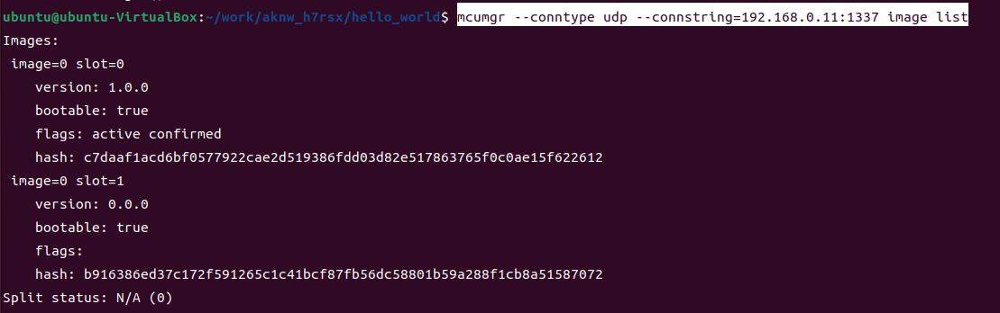
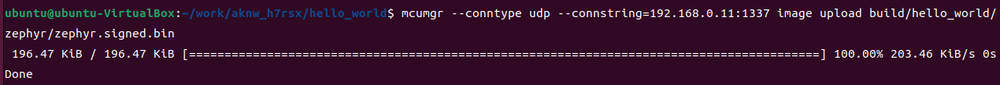
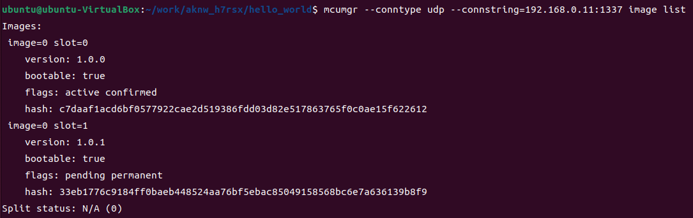
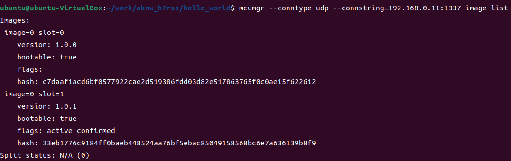
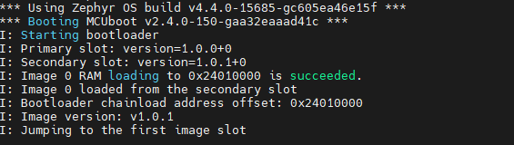

## 1. 依赖链：RAM_LOAD 模式下 `IMG_MANAGER` 被锁死了
 在之前的STM32F4上，我们使用了`IMG_MANAGER`来实现OTA，但是在STM32H7上，我们发现`IMG_MANAGER`在RAM_LOAD模式下被锁死了，所以我们需要自己实现OTA，来实现OTA功能。锁死的具体原因如下：
 1. `IMG_MANAGER` 默认 `y`，但 `CONFIG_MCUMGR_GRP_IMG=y` 没开，**被 Kconfig 静默丢弃**。
```10:14:zephyr/subsys/dfu/Kconfig
menuconfig IMG_MANAGER
	bool "DFU image manager"
	depends on STREAM_FLASH
	depends on !MCUBOOT_BOOTLOADER_MODE_RAM_LOAD || RETENTION_BOOTLOADER_INFO_OUTPUT_FUNCTION
	depends on !MCUBOOT_BOOTLOADER_MODE_RAM_LOAD_WITH_REVERT || RETENTION_BOOTLOADER_INFO_OUTPUT_FUNCTION
```
2. `MCUMGR_GRP_IMG` 默认 `y`，但 `CONFIG_MCUMGR_GRP_IMG=y` 没开，**被 Kconfig 静默丢弃**。
```15:19:zephyr/subsys/mgmt/mcumgr/grp/img_mgmt/Kconfig
menuconfig MCUMGR_GRP_IMG
	bool "MCUmgr handlers for image management"
	depends on FLASH
	depends on IMG_MANAGER
	depends on !MCUBOOT_BOOTLOADER_MODE_SINGLE_APP
```

3. `IMG_MANAGER` 在 RAM_LOAD 下必须配合 `RETENTION_BOOTLOADER_INFO_OUTPUT_FUNCTION`，后者需要一整条 retention 链：

```4:8:zephyr/subsys/retention/Kconfig
menuconfig RETENTION
	bool "Retention support"
	depends on RETAINED_MEM
	depends on DT_HAS_ZEPHYR_RETENTION_ENABLED
```

故在RAM_LOAD 下 app 无法自己推断 slot 布局，必须由 MCUboot 通过"保留内存"把自己的配置共享给 app。

## 2. 补全 retention 链
1. 添加下列配置,具体配置可参考https://nrfconnectdocs.nordicsemi.com/ncs/3.1.0-preview1/zephyr/services/retention/blinfo.html
**app 侧** `ota.conf`：
```conf
CONFIG_RETAINED_MEM=y
CONFIG_RETENTION=y
CONFIG_RETENTION_BOOTLOADER_INFO=y
CONFIG_RETENTION_BOOTLOADER_INFO_TYPE_MCUBOOT=y
```
2. 在ota.overlay以及mcuboot.overlay 添加下列内容：
**DTS（app 和 MCUboot 两边必须都有同一节点）** —— 用 SRAM1（`0x30000000`，16 KB，两边都没占用；热复位内容保留）：
```dts

/ {
	chosen {
		zephyr,bootloader-info = &retention0;
	};

	sram1_ret: memory@30000000 {
		compatible = "zephyr,memory-region", "mmio-sram";
		reg = <0x30000000 DT_SIZE_K(1)>;
		zephyr,memory-region = "RetainedMem";
		status = "okay";

		retainedmem {
			compatible = "zephyr,retained-ram";
			status = "okay";
			#address-cells = <1>;
			#size-cells = <1>;

			retention0: retention@0 {
				compatible = "zephyr,retention";
				status = "okay";
				reg = <0x0 0x40>;
				prefix = [04 fa];
				checksum = <1>;
			};
		};
	};
};
```
3. MCUboot 侧 
 `sysbuild/mcuboot.conf` —— 这是 blinfo Kconfig 里明确要求的：
```27:32:zephyr/subsys/retention/Kconfig.blinfo
  In order to use this, a retention area must be created and set as
  the "zephyr,bootloader-info" chosen node via device tree, MCUboot
  must be built with the same "zephyr,bootloader-info" DTS node and
  have CONFIG_BOOT_SHARE_DATA, CONFIG_BOOT_SHARE_DATA_BOOTINFO and
  CONFIG_BOOT_SHARE_BACKEND_RETENTION enabled
```
```conf
CONFIG_RETAINED_MEM=y
CONFIG_RETENTION=y
CONFIG_BOOT_SHARE_DATA=y
CONFIG_BOOT_SHARE_DATA_BOOTINFO=y
CONFIG_BOOT_SHARE_BACKEND_RETENTION=y
```

## 3. 升级流程
- 1.升级前，使用 mcumgr image list 命令查看当前镜像： 
```bash
mcumgr --conntype udp --connstring=192.168.0.11:1337 image list
```

- 2.使用 mcumgr image upload 命令上传镜像： 
```bash
mcumgr --conntype udp --connstring=192.168.0.11:1337 image upload build/hello_world/zephyr/zephyr.signed.bin
```

- 3.使用 mcumgr image list 命令查看升级后的镜像,新下载的镜像flags为:active confirmed

- 4.重启设备，使用 mcumgr image list 命令查看升级后的镜像,新下载的镜像flags为:active


- 5.也可在启动打印中看到升级成功:
